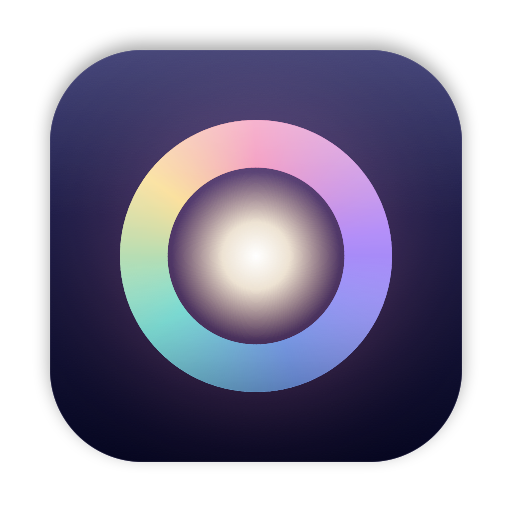
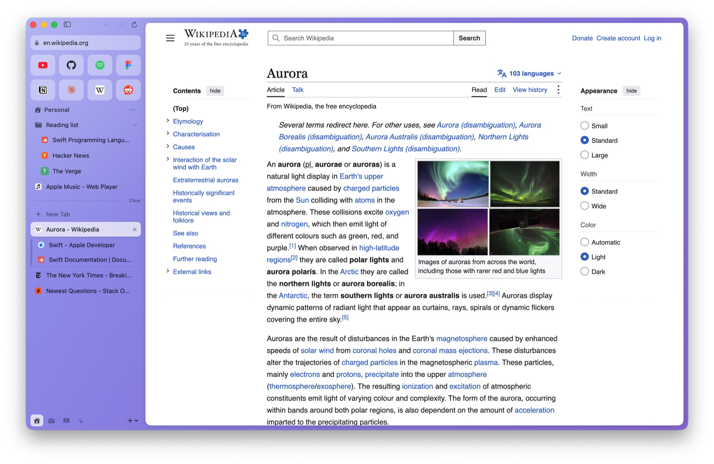
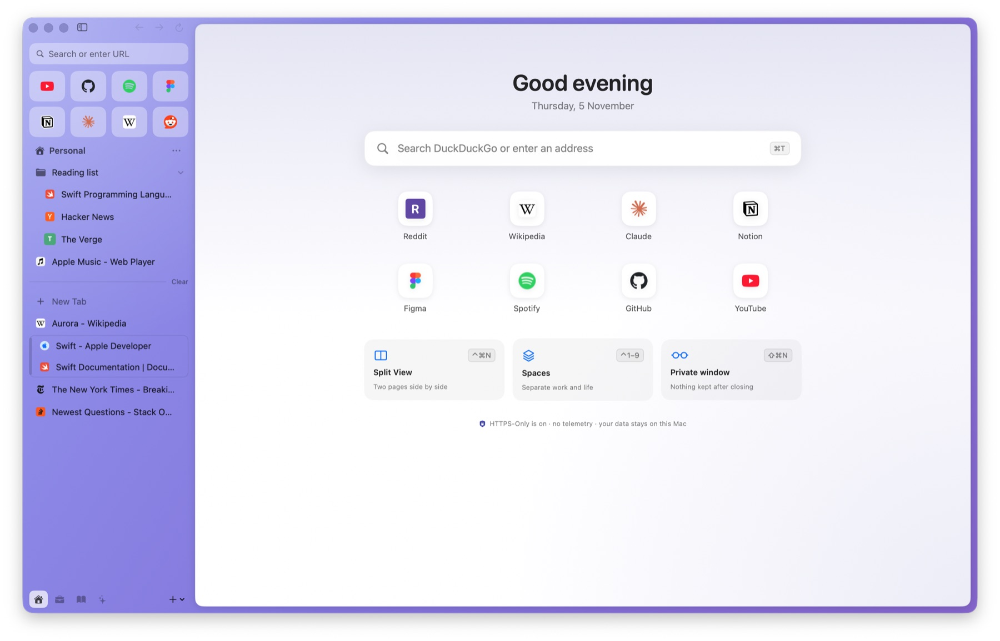
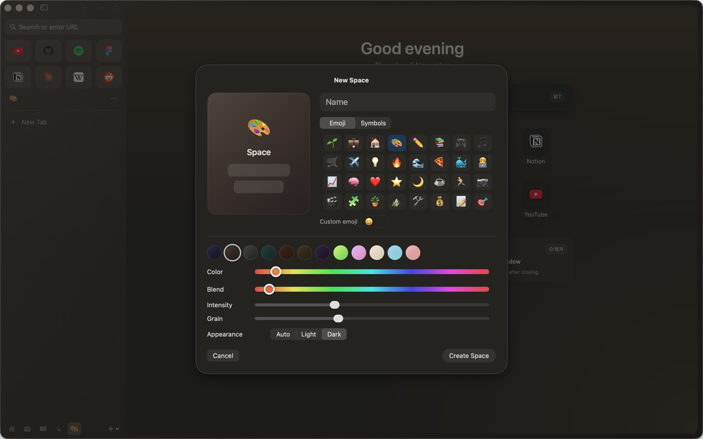
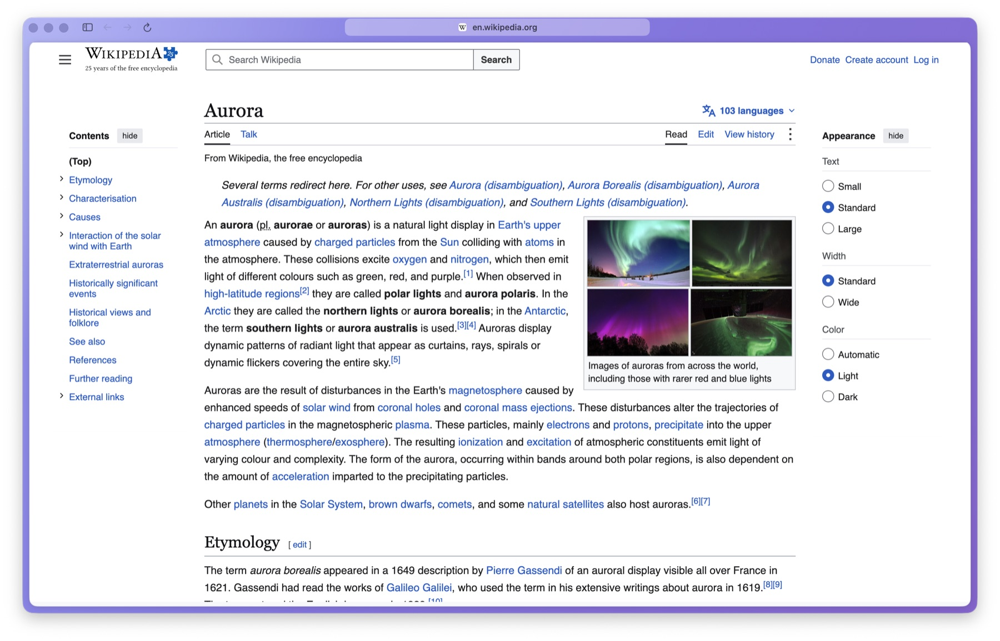

<p align="center"></p>

<h1 align="center">Nera</h1>

<p align="center">A native, private browser for macOS. Open source, no telemetry, built by an independent developer.</p>

<p align="center">
  <a href="LICENSE"></a>
  
  
</p>

Nera is a Mac browser with vertical tabs, Spaces, a command bar and Split View, written natively in Swift and
SwiftUI. It renders pages with Chromium (through the Chromium Embedded Framework) and keeps Apple's WebKit as a second
engine for sites that need it, such as streaming video.

<p align="center">
  
</p>

> **Status:** early. Expect rough edges, and please report them.

<p align="center"><a href="https://github.com/tariq235/nera/releases/latest"><b>Download Nera for macOS</b></a> · macOS 14 or later, Apple silicon · signed and notarized</p>

## Principles

- **Private by design.** No telemetry, no accounts, no ads. Your tabs, history and settings stay on your Mac. Every
  host Nera contacts on its own is listed in [PRIVACY.md](PRIVACY.md), and CI fails if code adds one without listing it.
- **Open.** Every line is MPL-2.0. Build it yourself and compare.
- **Secure.** HTTPS-Only by default, phishing and malware warnings (Google Safe Browsing: the full
  address never leaves your Mac), signed and notarized releases, signed updates, and security checklists with the tests that prove each item.
- **Native.** A real Mac app: fast to launch, light on memory, accessible with VoiceOver and the keyboard.

## Features

Vertical tabs and Spaces · Favorites and pinned tabs · command bar (⌘T, ⌘L) with open-tab search · Split View ·
Peek and Little Windows · import from Chrome, Safari, Firefox, Edge, Brave and Arc (bookmarks, history, sign-ins) ·
Chrome extensions (Manifest V3) · per-site permissions and engines · download safety · VoiceOver throughout.

<p align="center">
  
  
  
</p>

## Install

Download the latest disk image from [Releases](https://github.com/tariq235/nera/releases/latest), open it and drag Nera to Applications. Each release
lists SHA-256 checksums, a software bill of materials and a build provenance attestation. Nera updates itself with signed updates (you can turn this off
in Settings › General).

## Build from source

Requirements: macOS 14 or later on Apple silicon, Xcode 26 or later, Homebrew.

```sh
git clone https://github.com/tariq235/nera.git && cd nera
make bootstrap   # XcodeGen, SwiftLint
make build       # fetches and verifies the pinned Chromium Embedded Framework, then builds the app
make test-unit   # unit and engine tests
```

Builds you make yourself don't update themselves and don't include a Safe Browsing key: to enable phishing
protection in your own build, create a key restricted to the Safe Browsing API and pass it as
`NERA_SAFE_BROWSING_KEY` (see [docs/release/safe-browsing-key.md](docs/release/safe-browsing-key.md)).

## How it's built

No feature talks to a browser engine directly: everything goes through one engine contract that both engines pass
the same conformance suite for. Start with [docs/architecture.md](docs/architecture.md), the
[decision records](docs/adr/), and the [security model](docs/security/security-model.md). The
[checklists](checklists/) track every security, privacy, accessibility and performance requirement, each with the
test or document that proves it.

## Contributing and help

- Questions and ideas: [Discussions](https://github.com/tariq235/nera/discussions). Bugs and sites that don't work:
  [Issues](https://github.com/tariq235/nera/issues), using the form (please remove private details from logs and screenshots).
- Sending a change: [CONTRIBUTING.md](CONTRIBUTING.md). Security problems: privately, see [SECURITY.md](SECURITY.md).
- Nera is made by one person with AI assistance, so replies can take a few days.
- Supporting Nera: [GitHub Sponsors](https://github.com/sponsors/tariq235). Nera stays free, with no ads or telemetry either way.

## License

[MPL-2.0](LICENSE). Forks are welcome; please give yours its own name and icon. Third-party components and their
licenses: [THIRD_PARTY_NOTICES.md](THIRD_PARTY_NOTICES.md) and, in the app, "Chromium Credits". Arc, Chrome and the
other browsers mentioned are trademarks of their owners; Nera is an independent project and isn't affiliated with them.
