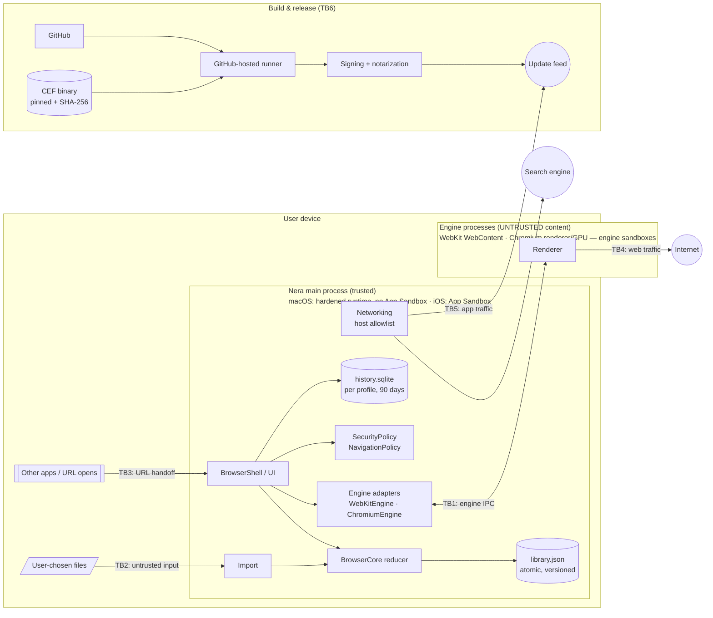

# Threat model (v1, 2026-10-25)

Scope: Nera for macOS (Chromium default engine, WebKit fallback) and iOS/iPadOS (WebKit). Method: assets → adversaries → trust boundaries → STRIDE per component. Every **High** threat maps to a `SEC-xxx` item in [checklist 000](../../checklists/000-browser-security.md), so its mitigation is tracked until it's proven. Review triggers and status: [checklist 010](../../checklists/010-threat-model-review.md).

## Assets

| Asset | Why it matters |
|---|---|
| Web credentials & sessions (cookies, tokens, passkeys) | Account takeover on every site the user uses |
| Browsing data (history, open tabs, Spaces, downloads) | Highly personal; reveals health, finance, work |
| The user's Mac/iPhone itself | A browser compromise is a common first step to device compromise |
| Nera's update channel and signing keys | One stolen key = malware pushed to every user |
| Nera's reputation for privacy | The product promise |

## Adversaries

| ID | Adversary | Capability |
|---|---|---|
| A1 | Malicious or compromised website | Arbitrary HTML/JS/WASM, may chain engine exploits |
| A2 | Network attacker (café Wi-Fi, malicious ISP) | Read/modify unencrypted traffic, strip TLS, DNS spoofing |
| A3 | Phishing operator | Look-alike domains, spoofed UI, social engineering |
| A4 | Malicious local app (same user) | Read user files, send Apple Events, inject into unhardened processes |
| A5 | Supply-chain attacker | Compromise a dependency, CEF download, CI runner or GitHub account |
| A6 | Malicious import file | Crafted JSON/plist/SQLite fed to an importer |
| A7 | Malicious extension (Chromium, later) | Extension APIs within granted permissions |
| A8 | Physical access to an unlocked or stolen device | Reads data at rest |

## Data flow & trust boundaries

| Boundary | Crosses | Rule |
|---|---|---|
| TB1 | Engine ⇄ main process | Everything from a renderer is untrusted. Requests are typed, validated and **default-deny** |
| TB2 | Files → importers | Parsers are total (never crash), size-capped, fuzzed |
| TB3 | Other apps → Nera | URLs pass the same `NavigationPolicy` with trigger `.linkClick`. No Apple-Event JS execution by default |
| TB4 | Web traffic | HTTPS-Only, engine TLS validation, HSTS, Safe Browsing |
| TB5 | App-level traffic | Allowlisted hosts only, pinned where we own the endpoint |
| TB6 | Supply chain | Pinned + hashed inputs, GitHub-hosted runners, maintainer-approved release environment, notarization |

## STRIDE by component

Rating: **H** = likely and severe · **M** · **L**.

### Main process: Shell, Core, Storage

| STRIDE | Threat | Rating | Mitigation | Tracked |
|---|---|---|---|---|
| S | Page spoofs browser UI (fake address bar, fake dialogs, fullscreen overlay) | H | Committed-URL display rules; dialogs attributed to origin; fullscreen notice | SEC-016, SEC-042, SEC-043 |
| T | Corrupted or downgraded library file destroys user data | M | Atomic writes, corrupt-file quarantine, newer-schema refusal | SEC-032, SEC-033 |
| R | — (single user, local) | L | — | — |
| I | URLs/titles leak through logs or crash reports | H | `os_log` `.private`, crash scrubbing | SEC-070 |
| I | Browsing history reveals private activity (A8, or private sessions written to disk) | M | Private (ephemeral) pages are never recorded; 90-day retention; clear by range; iOS file protection; stays on device | FEAT-022 |
| D | Crash loop at launch makes the app unusable | M | Safe mode after 2 launch crashes | SEC-054 |
| E | Local app injects code into the unsandboxed macOS main process | H | Hardened runtime, library validation, no dangerous entitlements, CI entitlement gate | SEC-050, SEC-051, SEC-053 |

### Engine adapters & engine processes (TB1)

| STRIDE | Threat | Rating | Mitigation | Tracked |
|---|---|---|---|---|
| S | Phishing / look-alike domains | H | Safe Browsing, punycode display, credential-URL block | SEC-018, SEC-017, SEC-013 |
| T | Network attacker modifies pages | H | HTTPS-Only, HSTS, mixed-content blocking, no cert bypass | SEC-001, SEC-003, SEC-007, SEC-004 |
| I | Cross-site data theft (Spectre-class, cookie leaks) | H | Renderer sandbox, site isolation, SameSite, COOP/COEP verified | SEC-020, SEC-021, SEC-023, SEC-024 |
| I | Profiles or private windows leak into each other | H | Per-profile data stores, ephemeral private store, leak tests | SEC-030, SEC-031 |
| D | Renderer crash or hang takes down the UI | M | Out-of-process engines; sad-tab + reload; memory-pressure eviction | SEC-055 |
| E | Renderer exploit escapes to the main process | H | Engine sandboxes on; forbidden switches; minimal per-helper entitlements; fast security rebases | SEC-020, SEC-026, SEC-052, SEC-066 |
| E | Page abuses permission prompts (camera/mic) or dialogs | H | Origin-attributed prompts drawn inside the content area, default-deny `Decision`, dialog flood throttle | SEC-040, SEC-041, SEC-042 |
| E | Page triggers navigation to `javascript:`/`file:`/external apps | H | `NavigationPolicy`, identical in both adapters | SEC-010, SEC-012, SEC-014, SEC-019 |

### Downloads & files

| STRIDE | Threat | Rating | Mitigation | Tracked |
|---|---|---|---|---|
| T/E | Drive-by download auto-opened, or Gatekeeper bypassed | H | Quarantine xattr, never auto-open, dangerous-type warning | SEC-044, SEC-045 |
| T | Server-suggested filename escapes the Downloads folder, hides itself or spoofs its extension | H | `DownloadPlanner`: last path component only, no leading dots, bidi controls stripped, never overwrite | SEC-046 |

### Importers (TB2)

| STRIDE | Threat | Rating | Mitigation | Tracked |
|---|---|---|---|---|
| D/E | Crafted file crashes or exploits the parser | M | JSONSerialization (memory-safe Swift), total functions, fuzzing | SEC-067 |
| I | Importer reads more than the user chose | M | Reads only the user-picked file | PRV-009 |

### App-level networking & updates (TB5)

| STRIDE | Threat | Rating | Mitigation | Tracked |
|---|---|---|---|---|
| T | Malicious update via a compromised feed or MITM | H | EdDSA + Apple signature, HTTPS, pinning on our endpoints | SEC-060, SEC-008 |
| I | Undisclosed background requests (privacy breach) | H | Network inventory (CI) + runtime allowlist; Chromium background-request audit | SEC-062, SEC-063, PRV-006 |

### Build & release pipeline (TB6)

| STRIDE | Threat | Rating | Mitigation | Tracked |
|---|---|---|---|---|
| T | Compromised dependency or CEF download | H | Pinned versions + SHA-256, OSV scan, minimal dependencies | SEC-065 |
| T | Persistent compromise of the CI runner | H | Ephemeral VM per job, no fork PRs, scoped token | TM-005 |
| S/E | Stolen signing or Sparkle key | H | Keys only in the release environment's secrets and an offline backup; maintainer-approved releases; notarization | SEC-061, TM-006 |
| T | Secret committed to the repo | M | gitleaks on every PR | SEC-064 |
| R | Can't prove what was shipped | M | SBOM, provenance attestations, reproducibility check | REL-008, REL-009, SEC-069 |

### Future surfaces (sections required before the feature starts)

Extensions (A7), Sync (cloud + sharing), Intelligence (prompt injection from page content into on-device models), AppleScript automation. Tracked in TM-008.

## Residual risks we accept (for now)

- **macOS main process is not App-Sandboxed** (Chromium requirement, ADR-0006). Compensated by the hardened runtime, library validation, minimal entitlements, and engine sandboxes for all web content.
- **Zero-day engine exploits** are possible on any engine. Our lever is patch speed: the SEC-066 SLA.
